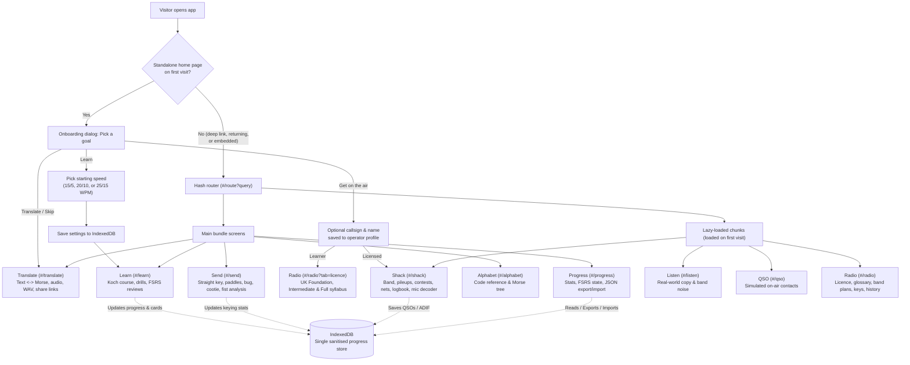

# Morse Code

Translate, learn, send, and operate in Morse code: a Koch method course, sending practice with straight keys or paddles, real-world copy drills, simulated HF bands and QSOs, and UK amateur radio licence study tools.

Built as a static single-page application with no backend server, no database, and no API keys. All audio synthesis, keying, decoding, and progress storage run locally in the browser.

- [ARCHITECTURE.md](ARCHITECTURE.md): concise overview of how the modules fit together.
- [HANDOFF.md](HANDOFF.md): building, embedding on an Astro site, browser support, and deployment checklist.
- [CONTENT.md](CONTENT.md): adding lessons, word lists, glossary terms, licence questions, and contests.
- [PLAN.md](PLAN.md): the phased build plan and what each phase delivered.

## User Flow

The application uses hash-based routing (`#/translate`, `#/learn`, `#/radio?tab=keys`) so it works from any sub-path on a static host without server rewrite rules. First-time visitors landing on the standalone home page see a brief onboarding dialog; deep links go straight to the requested screen.



## Technical Architecture

### Tech Stack

| Layer | Choice | Role |
|---|---|---|
| UI | Preact 11 | Lightweight component rendering |
| State | `@preact/signals` | Fine-grained reactivity for shared and local state |
| Language | TypeScript (strict) | Type safety across app, pure logic, and tests |
| Build | Vite 6 | Standalone bundle (`dist/`) and embeddable library (`dist-lib/`) |
| Persistence | `idb-keyval` (IndexedDB) + `localStorage` | Progress, FSRS state, logbook, and viewer preferences |
| Spaced Repetition | `ts-fsrs` | Adaptive character and review scheduling |
| Typography | Fontsource (self-hosted WOFF2) | Fraunces, Atkinson Hyperlegible, and JetBrains Mono |
| Testing | Vitest + Playwright | Unit tests, content checks, E2E, accessibility, and visual snapshots |

### Entry Point, Routing, and Code Splitting

- **Single entry point (`src/embed.ts`)**: `mount(el, options)` adds `.mc-root`, binds theme state, starts the hash router, renders `<App />`, and optionally registers the service worker. `src/main.ts` (the standalone page) is a single call to `mount()`, and `<MorseCode />` wraps it as a Preact component for Astro islands.
- **Hash routing (`src/app/router.ts`)**: Parses `#/section?query` routes and listens to `hashchange`. Route transitions use the View Transitions API when supported and `prefers-reduced-motion` is not enabled. Screens read their own query parameters (`tab`, `term`, `t`) via `hashQuery()`.
- **Bundle splitting (`src/app/App.tsx`)**: Core screens (`Translate`, `Learn`, `Send`, `Alphabet`, `Progress`) ship in the main bundle. Amateur radio screens (`Listen`, `QSO`, `Shack`, `Radio`) are dynamically imported on first visit and cached via a `once()` helper. `scripts/check-size.mjs` enforces a 150 KB gzipped first-load budget (currently around 72 KB).
- **Theme and i18n (`src/app/theme.ts`, `src/app/i18n.ts`)**: Supports `light`, `dark`, and `system` themes. Host pages can control the theme programmatically via `app.setTheme()` or `postMessage({ type: 'mc:theme', theme })` for iframes. Shell and onboarding strings are read through `t()` and can be overridden with `mount(el, { messages })`.

### Pure Logic Layer (No DOM)

All domain logic is decoupled from Preact and the DOM so it can be unit-tested directly under Node with Vitest:

- **`src/core/`**: Text-to-Morse and Morse-to-text codec (including prosigns and `{...}` literals), PARIS and Farnsworth timing calculators, event schedule builders, sample-stepped electronic keyer logic (iambic A/B, ultimatic, bug, and cootie), adaptive dit/dah threshold decoder, fist analysis, and Goertzel tone detection.
- **`src/learn/`**: Koch method progression, drill generators, copy grading, FSRS review scheduling, statistics, IndexedDB progress storage (`sanitizeProgress()`), callsign and zone generators, QSO script engines, contest simulator, nets, radiograms, HF band propagation model, and an ADIF-compatible logbook.
- **`src/reference/`**: UK licence syllabus engine (study notes, practice ordering, and timed mock exams with authentic section weightings), auto-linked glossary (`Help` component in `src/ui/Linked.tsx`), and timing rules for alternative codes such as American Morse.

### Web Audio Pipeline

- **Shared `AudioContext` (`src/audio/engine.ts`)**: One shared audio context, resumed on the first user gesture to satisfy browser autoplay rules.
- **Look-ahead scheduler (`Player`)**: Schedules tone envelopes a few hundred milliseconds ahead on the Web Audio clock, allowing glitch-free pause, seek, looping, and live WPM adjustments. Selectable voices (sine, buzzer, radio, sounder) shape each tone, and schedules can be rendered offline to WAV files.
- **Simulated HF band (`BandRig` and `Chorus`)**: Synthesises realistic radio conditions including band noise, static crashes (QRN), fading (QSB), interference (QRM), hum, flutter, echo, a two-stage receiver filter, RIT, AGC, and concurrent multi-station pileups.
- **Inline `AudioWorklet`s (`src/audio/worklets/`)**: Worklet processors are assembled from source strings at runtime and loaded via `blob:` URLs, avoiding extra static files across dev, standalone, and embedded builds. They power the sample-accurate paddle keyer + sidetone (reporting exact key-down/up timestamps to the decoder) and the local Goertzel tone detector for the microphone off-air decoder.

### State, Persistence, and Offline Support

- **State**: Component-local state uses Preact hooks/signals; shared application state (route, theme, progress, messages) lives in module-level signals.
- **Progress storage (`src/learn/progress.ts`)**: Stored as a single JSON object in IndexedDB and passed through `sanitizeProgress()` on every load or import, ensuring older saves or hand-edited exports never break the app.
- **Preferences**: Lightweight viewer settings (sound, speeds, radio controls, onboarding flag) are stored in `localStorage` inside `try/catch` guards so blocked storage degrades cleanly to defaults.
- **Offline caching (`public/sw.js`)**: A custom Vite plugin (`mc-precache` in `vite.config.ts`) emits `precache.json` listing built assets and Latin WOFF2 font subsets. The service worker serves HTML network-first and hashed assets cache-first, scoped strictly to `./` so it never interferes with a parent site.

### Styling and Accessibility

- Plain CSS modules under `src/styles/`, all scoped beneath `.mc-root` so embedded instances do not collide with host site styles.
- Every colour is defined as a `--mc-*` custom property in `src/styles/tokens.css` for both light and dark themes. `npm run lint:tokens` fails the build if a raw colour appears anywhere else, and `tests/contrast.test.ts` verifies text/background pairs against WCAG AA contrast ratios.

## Project Layout

```text
content/       Data files: alphabets, Koch order, Markdown teaching cards, word lists,
               contests, UK licence syllabus notes/questions, glossary, other codes, history
public/        Static assets including sw.js (offline service worker)
scripts/       Build and verification scripts (token lint, size budget, local embed server)
src/
  app/         Shell (App.tsx), hash router, theme binding, i18n, onboarding, settings/share links
  audio/       Shared AudioContext, look-ahead Player, voices, BandRig, Chorus, AudioWorklets, WAV export
  core/        Pure logic (no DOM): codec, timing, schedules, keyer, adaptive decoder, fist analysis
  features/    Screen folders: translate, learn, listen, send, qso, shack, radio, alphabet, progress
  input/       Keyboard, Web MIDI, and Web Serial key/paddle drivers
  learn/       Koch course, drills, FSRS, stats, IndexedDB store, contest/QSO/band/logbook engines
  reference/   UK licence syllabus engine, glossary and automatic term linking, other-code timing
  styles/      Design tokens (tokens.css), base, shell, instruments, and per-screen CSS
  ui/          Reusable instruments: Code pills, Lamp, Tape, Scope, TimingRuler, MorseTree, KeyButton
  embed.ts     mount(el, options) and <MorseCode /> entry point
  main.ts      Standalone bootstrap calling mount()
tests/         Vitest unit tests for pure logic, content integrity, and WCAG AA contrast
e2e/           Playwright browser tests (desktop, phone, visual snapshots, parity, embed/offline)
legacy/        Original single-file page retained for parity testing
```

## Getting Started

Requires **Node.js 20 or later**.

```bash
npm ci
npm run dev
```

For browser tests, install Playwright's Chromium binary once:

```bash
npx playwright install chromium
```

### Commands

| Command | Purpose |
|---|---|
| `npm run dev` | Start the Vite development server with hot reload |
| `npm run build` | Typecheck (`tsc --noEmit`), token lint, production build to `dist/`, and 150 KB first-load budget check |
| `npm run preview` | Serve the production build in `dist/` locally on `http://localhost:4173/` |
| `npm run build:lib` | Build the embeddable library to `dist-lib/` (`morse-code.js` + `morse-code.css`) |
| `npm test` | Run Vitest unit and content integrity tests |
| `npm run check` | Fast verification: typecheck + token lint + unit tests |
| `npm run lint:tokens` | Fail if any raw colour exists outside `src/styles/tokens.css` |
| `npm run size` | Re-run the first-load bundle size check on `dist/` |
| `npm run test:e2e` | Run Playwright tests against the production build (desktop, phone, embed, offline) |
| `npm run test:long` | Run the long full-speed rag-chew test (desktop only) |
| `npm run test:visual` | Run visual regression snapshots (add `-- --update-snapshots` after intended UI changes) |
| `npm run test:all` | Run `check` followed by all Playwright tests |

Set `MC_BASE=/some/path/` when building to pin an absolute base path instead of the default relative `./`.

## Embedding and CSP

```ts
import { mount } from './src/embed';

const app = mount(document.getElementById('morse')!, { theme: 'system' });
app.setTheme('dark');
// Clean up on route/view transitions:
app.unmount();
```

From a parent page hosting an iframe:

```js
iframe.contentWindow.postMessage({ type: 'mc:theme', theme: 'dark' }, '*');
```

If your host page sends a Content Security Policy header, include:
- `script-src 'self' blob:` (required for the keyer and tone-detector AudioWorklets)
- `media-src 'self' blob:` and `connect-src 'self'` (for WAV export and `precache.json`)
- `worker-src 'self'` (if using the standalone offline service worker)

Full integration guides for static hosting, library mounting, and Astro islands are in [HANDOFF.md](HANDOFF.md).

## Usage Notes

### Input Syntax (Translate)

- **Prosigns**: `<SK>` or `[AR]` send the letters run together without inter-character spacing.
- **Literals**: `{...}` passes text through untouched in either mode so unsupported characters survive switching direction.
- **Morse input**: Spaces separate letters; `/`, `|`, or three spaces separate words. Unicode bullets, middle dots, dashes, and `_` are accepted alongside `.` and `-`.

### Keys and Paddles (Send)

- **Straight key**: Hold **Space**, or press the on-screen key.
- **Paddles**: `[` = dit, `]` = dah, or **Left/Right Ctrl** (the default mapping for most USB paddle adapters). Supports Iambic A, Iambic B, Ultimatic, and single-lever modes.
- **Bug and Cootie**: For a bug, `[` drives the automatic dit pendulum and `]` keys manual dahs. For a cootie, both sides key directly.
- **Hardware keys**: Web MIDI (first note pressed = dit/key, second = dah) and Web Serial (CTS = dit/key, DSR = dah) are supported in desktop Chrome and Edge.

### Radio and Licence

Includes UK Foundation, Intermediate, and Full licence study notes, practice drills, and timed mock exams, alongside a cross-linked glossary, UK and IARU Regions 1 to 3 band plans, UK CW operating scene notes, keys, rigs, other codes, beacons, signal lamps, and history. Open tabs or glossary entries directly via `#/radio?tab=keys` or `#/radio?tab=glossary&term=qsb`.

Licence content lives in `content/licence/s1.json` through `s9.json` (one entry per syllabus item; the correct answer is always listed first and shuffled on screen). `tests/fixtures/syllabus-levels.json` maps each item to its licence levels and is verified by unit tests.

### The Shack

Features a simulated HF band, callsign trainer, pileup trainer, contests, portable activations, nets, operating etiquette, an ADIF logbook, and an off-air microphone decoder (all audio is processed locally on the device). Contest function keys: **F1** CQ, **F2** exchange, **F3** log + TU, **F4** your call (search and pounce), **F5/F6** again, and **Enter** to step through each contact.
